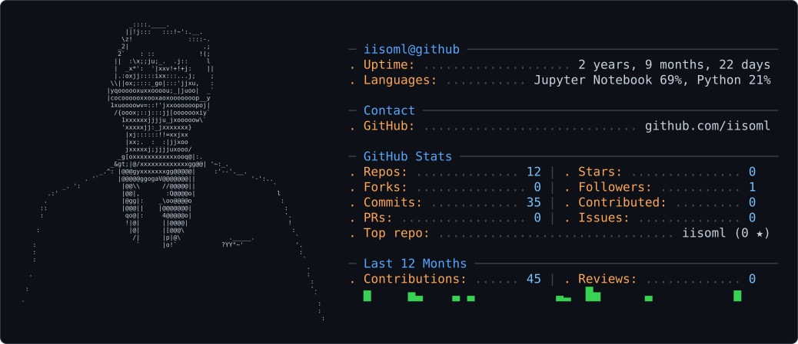

<picture>
  <source media="(prefers-color-scheme: dark)" srcset="dark_mode.svg">
  <source media="(prefers-color-scheme: light)" srcset="light_mode.svg">
  
</picture> 

 

## Hi, I'm Ismail El Boudi

**Data Engineering student** at **ENSAO** (Data Science & Cloud Computing), based in Rabat, Morocco 🇲🇦

I build data pipelines and asynchronous backend systems with Python, SQL, Airflow and Docker.

 **Currently looking for a 4–6 month end-of-studies internship (PFE) in Data Engineering / Cloud Data, starting February 2027**, in France or Germany (internship agreement from my university available).

  
  

---

## Tech Stack

**Languages & Databases**

-ED8B00?style=flat-square&logo=openjdk&logoColor=white)

**Data Engineering**

**Backend & Infrastructure**

-232F3E?style=flat-square&logo=amazonwebservices&logoColor=white)

**Data Science & Tools**

---

## Featured Projects

###  TradingAgents SaaS Platform
`FastAPI` · `Next.js` · `Celery` · `Redis` · `PostgreSQL` · `Docker`

A SaaS web product built around the open-source multi-agent LLM framework **TradingAgents**.
- FastAPI backend + Next.js user interface
- Long-running analyses executed asynchronously (Celery + Redis) so jobs never block the API
- Multi-tenant PostgreSQL data model with quotas/credits and Stripe payments

###  Weather ETL Pipeline
`Airflow` · `PostgreSQL` · `Docker` · `Python`

- Automated ETL pipeline with Apache Airflow for scheduled ingestion and storage of weather data in PostgreSQL
- Full infrastructure containerized end to end with Docker Compose

###  Social Network Database Design
`SQL` · `Oracle SQL` · `Data Modeling`

- Relational schema designed in 3NF, with optimized queries and robust relational triggers

###  AgrInvest *(team project)*
- AI-driven agricultural investment platform connecting investors and Moroccan farmers

---

##  Experience

**Software / Data Engineer Intern: ZelvIT** · Rabat, Morocco · *Jul 2026 – Aug 2026*
- Industrialized a distributed backend wrapping a multi-agent LLM engine (LangGraph) behind an execution facade (Engine Adapter)
- Built a decoupled asynchronous execution pipeline (FastAPI, Celery, Redis) for job queuing and state tracking
- Designed a multi-tenant PostgreSQL schema covering transactions, usage quotas/credits and Stripe webhooks
- Containerized the API, Celery workers and Redis with Docker Compose for reliable VPS deployment

**Data Scientist Intern: Intercallia SARL** · Rabat, Morocco · *Jul 2025*
- Cleaned, analyzed and visualized data to ensure quality and usability
- Wrote Python automation scripts; worked with SQL and NoSQL databases
- Contributed to solutions deployed on cloud environments

---

##  Hackathons & Competitions

| Result | Event | Date |
|---|---|---|
|  **1st place** | DiNext'26 Hackathon, Faculty of Sciences, Oujda | May 2026 |
|  **Top 10** | MIATHON'03, MIA Maroc / Mohammed I University (72-hour build & pitch) | May 2026 |
|  **4th place** | Automate or Die Challenge, Tunis (IEEE), 170+ teams | Jul 2026 |

---

##  Education & Certifications

- **ENSAO** (National School of Applied Sciences, Oujda): Engineering Degree in **Data Science & Cloud Computing** · *Sept 2024 – Present*
  Data Engineering, Cloud Infrastructure, Advanced SQL, OLAP Cubes & Data Warehousing
- **CPGE Salmane Al Farisi, Salé**: Preparatory Classes for Engineering Schools (TSI) · *2022 – 2024*
-  **Data Engineer Certificate**: DataCamp (April 2026)

---

##  Languages

Arabic (native) · French (B2) · English (B2)

---

##  Let's connect

I'm open to **Data Engineering / Cloud Data** internship opportunities for **February 2027**. Feel free to reach out on [LinkedIn](https://www.linkedin.com/in/ismail-el-boudi-0b4089410/) or by [email](mailto:elboudiismail8@gmail.com).